# MyTravelPlan

> 일정, 예산 관리부터 기록, 쇼핑, 학습까지 여행을 편리하게 계획할 수 있는 서비스입니다.


# **📊 프로젝트 개요**

- 개발 기간: 2026.06 ~ 개선 중
- 수정 기간 : 진행 중
- 참여 인원: 1명
- [프론트엔드 (Vercel)](https://mytravelplan.vercel.app/)
- API 문서
  - [RestDocs API 문서](http://43.201.147.146:8080/docs/index.html)
  - [Swagger + RestDocs(OpenAPI 3) API 문서](http://43.201.147.146:8080/swagger-ui/swagger-ui.html)

# 📝 요구사항 분석

## 주요 기능(Features) 및 요구사항

### **✈️** 여행 (Trip)

- **📆 시작 일자 선택:** 여행의 시작 일자를 자유롭게 선택하세요! 여러분의 여행이 시작될 날을 선택하면, 꿈꾸던 여행이 현실로 한 걸음 더 다가옵니다!
- **🏁 종료 일자 설정:** 종료 일자도 간편하게 설정할 수 있어요! 여행이 끝나는 날짜를 선택하면, 일정이 완벽하게 마무리됩니다.
- **🧑‍🤝‍🧑 동행자 초대:** 여행을 생성하고 나서 초대 링크를 생성해서 동행자에게 공유해주세요. 초대받은 사용자(동행자)는 해당 여행에 접근하여 정보 확인 및 참여 가능합니다!

하나의 여행에는 여행을 조금 더 쉽게 할 수 있도록 도와주는 다음의 하위 기능이 포함되어 있습니다.

### 📅 일정 (Schedule)

- **🗓️ 일정 관리:** 여행 일정을 날짜 시간 단위로 추가, 수정, 삭제할 수 있습니다.
- **💸 지출 정보 연동:** 개별 일정을 등록할 때 지출 정보도 함께 지정해보세요. 내가 언제 어디서 지출했는지 일일히 찾을 필요가 없습니다.
- **📍 여행 장소 지정:**
  - 각 일정에 여행 장소를 지정해줄 수 있습니다. 원하는 장소를 간편하게 검색해 보세요! ✈️ 여행 계획이 더 쉬워집니다.
  - 원하는 여행 장소가 없다면 나만의 여행 장소를 직접 만들어서 일정에 추가할 수 있습니다.
  - 여행 장소를 통해 상세 주소, 설명, 좌표, 외부 Map 서비스 URL 정보를 확인할 수 있습니다.
  - 기존에 스크랩한 장소들을 쉽게 확인하고 활용할 수 있어요.

### 🧳 체크리스트 (Checklist)

- **📋 효율적 관리:** 체크리스트 관리로 여러분의 여행 준비를 더 효율적으로 만들어보세요!
- **📂 카테고리 분류:** 카테고리별로 체크리스트를 분류할 수 있습니다.
- **📊 진행률 확인:** 체크리스트에서 각 항목의 완료 여부를 간단하게 조정하여 각 항목의 진행률 확인할 수 있습니다.
- **👥 항목 분리:** 이거는 내가, 이거 너가 가져오고, 이거는 다 같이 가져오고 복잡하게 생각하지 마세요. **모두의 준비물**과 **나의 준비물**로 분리해서 체크리스트를 관리할 수 있습니다.

### 📊 가계부 (Expense Manager)

여행 전 경비를 계획할 때, 여행 중 경비를 기록할 때, 여행 후 경비를 정산할 때,
여행을 준비하는 순간부터 여행이 끝난 시점까지 모든 순간 간편하게 관리해 보세요.

- **💰 지출 & 예산 추가하기**
  - 경비의 특징에 따라 나누어 추가하세요. (지출 뿐 아니라 내 예산과 공동경비 추가까지 가능해요)
  - **💱 자동 환율 계산:** 여행 생성 시 여행 국가를 지정하면 여행 국가에 맞는 여행 환율 정보가 세팅이 됩니다.
    - 원한다면 환율 값을 수정할 수 있습니다.
    - 추후 지출의 환율 정보를 추가할 때, 수정된 값으로 기본값이 세팅이 됩니다.
    - 기본값이 아닌 원하는 값으로 직접 전달하는 것도 가능해요.
- **👤 개인 & 👥 공동경비 관리하기**
  - 예산의 특징에 따라 나누어 관리하세요.
  - 실시간으로 잔고 내역을 한눈에!
- **🧾 지출 정산하기**
  - 정산 방법에 따라 다르게 기록하세요.
  - **➗ 1/N**과 **✍️ 직접 정산** 중에 선택할 수 있어요.
  - 어떻게 결제했는지 바로알기!
- **✅ 정산 금액 확인하기**
  - 자동으로 정산된 금액만 확인하세요. (여행의 끝은 깔끔한 정산이니까!)
  - **🔄 최소 정산 횟수 계산:** 누가 누구에게? 복잡하게 생각하지 마세요. 가장 적은 횟수로 비용을 주고받을 수 있도록 계산하는 기능이 있습니다.

### 📝 일기 (Diary)

- **✏️ 작성:** 사용자별로 여행 중 일기 작성(제목, 내용, 날짜 등) 할 수 있습니다.
- **🔍 조회/검색:** 작성된 일기 조회/검색할 수 있습니다.

### **🛍️ 쇼핑(Shopping)**

### 🧸 상품(Product)

- **🏪 판매자 기능:** 판매자는 상품을 등록, 수정, 삭제가 가능합니다.
- **📂 카테고리:** 상품은 카테고리별로 분류가 되어 있습니다.
- **👤 사용자 기능:** 사용자는 각 상품에 대한 상세 정보를 보거나, 리뷰, 문의글을 작성할 수 있습니다.

### **🛒 장바구니(Shopping Cart)**

- 사용자는 원하는 상품을 골라서 장바구니에 담을 수 있습니다.

### **📦 주문(Order) & 🚚 배송(Delivery)**

- **📋 판매자 기능:** 판매자는 주문 상태를 업데이트 할 수 있습니다.
- **🔎 사용자 기능:** 사용자는 주문, 배송 정보를 조회할 수 있습니다.

### 💬 커뮤니티(Community)

### 📝 게시물(Post)

- **✍️ 작성 및 관리:** 사용자는 자유롭게 게시물(글, 사진, 영상 등)을 작성, 수정, 삭제할 수 있습니다.
- **👀 조회:** 다른 사용자의 게시물을 조회하고 탐색할 수 있습니다.
- **🤝 상호작용:**
  - 게시물에 **❤️ 좋아요**를 누를 수 있습니다.
  - 관심 있는 게시물을 **📌 북마크**하여 나중에 다시 볼 수 있습니다.
- **💭 소통:** 게시물에 댓글을 작성하여 다른 사용자와 의견을 나눌 수 있습니다.

### 👥 팔로워 & 팔로잉 (Follower, Following)

- **🔗 관계:** 사용자는 다른 사용자를 **팔로우**하거나 **언팔로우**할 수 있습니다.
- **📄 목록 조회:** 나의 **팔로워** (나를 팔로우하는 사용자) 목록과 **팔로잉** (내가 팔로우하는 사용자) 목록을 확인할 수 있습니다.
- **📰 피드:** 내가 팔로우하는 사용자의 게시물을 모아보는 개인화된 피드를 제공받을 수 있습니다.

### 🎓 학습(Education)

### 🗂️ 플래시 카드 단어 학습 (Deck, Card)

- **📚 Deck (단어장) 관리:** 사용자는 Deck(단어장)을 생성/관리할 수 있습니다.
- **🃏 Card (단어) 추가:** 하나의 Deck(단어장)에는 여러 개의 원하는 단어(Card)들을 추가할 수 있습니다.

### ❓퀴즈 (Quiz)

- **▶️ 퀴즈 시작:** 사용자는 원하는 Deck들을 골라서 퀴즈를 시작할 수 있습니다.
- **🎮 퀴즈 모드:** **SelfReview**(직접 복습), **Dictation**(받아쓰기), **MultipleChoice**(객관식) 모드 중 하나를 선택해 시작 할 수 있습니다.
- **🧮 채점:** 퀴즈를 완료하면 사용자가 입력한 답변을 바탕으로 채점 결과가 생성이 됩니다.
- **📈 결과 확인:** 사용자는 퀴즈 결과 내역(정답률, 틀린 단어 등)을 볼 수 있습니다.

# 🛠️ 기술 스택

**Backend**

- Java
- Spring Boot
- Spring Security
- Spring Data JPA
- QueryDSL

**Library**

- JJWT
- MapStruct
- OpenCSV

**DevOps(CI/CD & Cloud)**

- GitHub Actions
- Docker
- AWS EC2, AWS RDS, AWS S3

**Development & Tools**

- IntelliJ IDEA
- Git, GitHub
- Notion

**Database**

H2 Database (Testing), MySQL (Production), Redis

**API & Documentation**

- Swagger, REST Docs
- Draw.io

**Authentiation(OAuth2.0)**

- Kakao
- Naver
- Google

**Testing**

- Postman
- JUnit5, Mockito
- JaCoCo
- Apache JMeter

# 🗂️ 프로젝트 구조

## 시스템 아키텍처

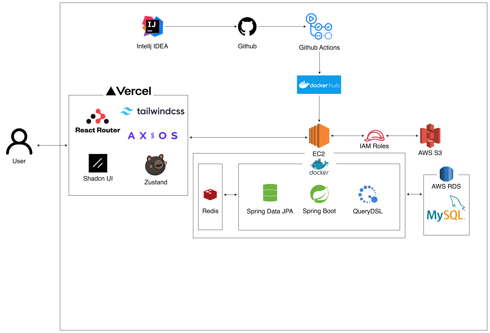

### 프레임워크 및 라이브러리

- Spring Boot, Spring Data JPA, QueryDSL을 기반으로 애플리케이션을 개발하였습니다.

### 데이터베이스

- AWS RDS(MySQL)을 사용하여 안정적이고 확장 가능한 데이터 관리를 구현하였습니다.

### CI/CD 파이프라인

- GitHub을 소스코드를 관리하였습니다.
- Github Actions을 활용하여 자동 빌드 및 Docker 이미지를 생성하였습니다.
- 빌드된 이미지는 Docker Hub을 거쳐 AWS EC2 인스턴스에 최종 배포하였습니다.

### 파일 업로드

- Presigined URL을 활용하여 클라이언트가 AWS S3에 직접 파일을 업로드 할 수 있게 하였습니다.

## 패키지 구조

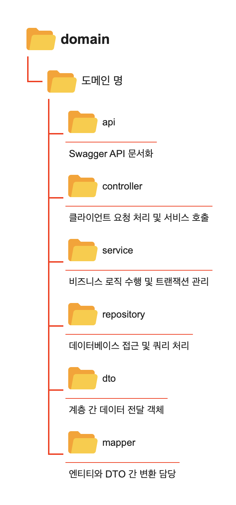

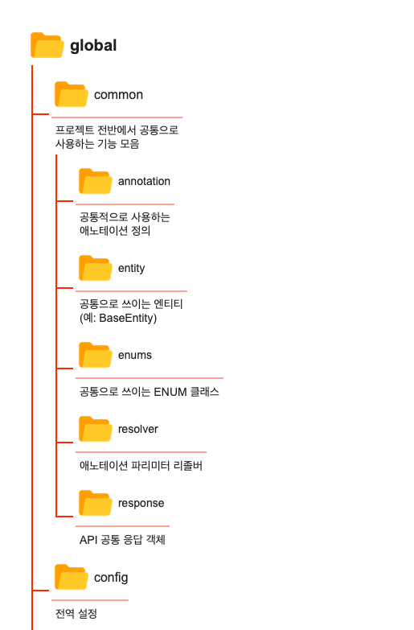

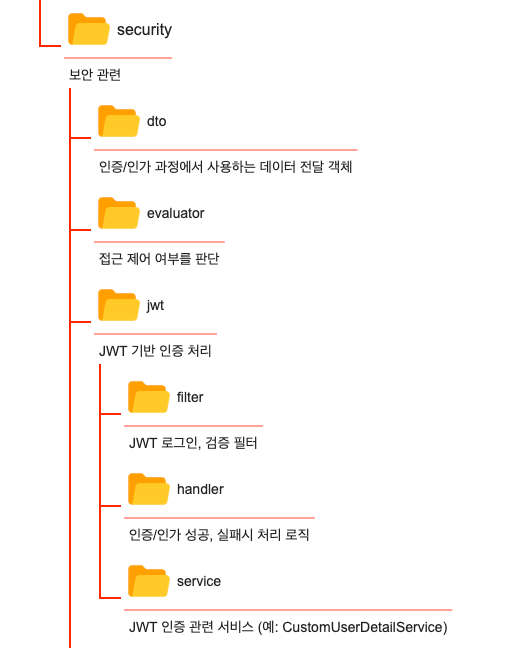

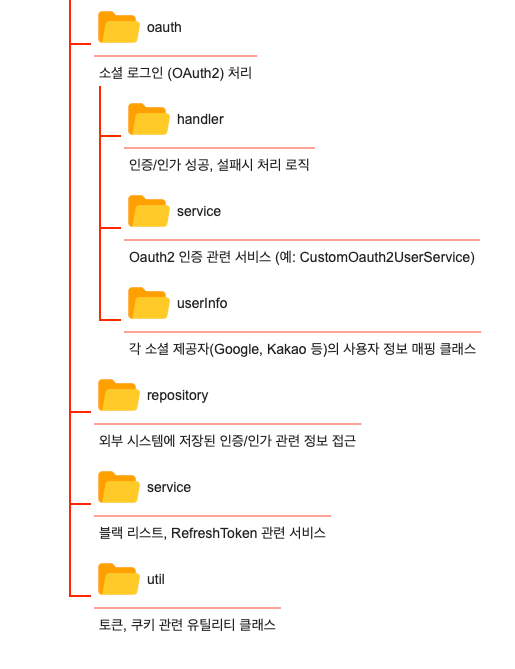

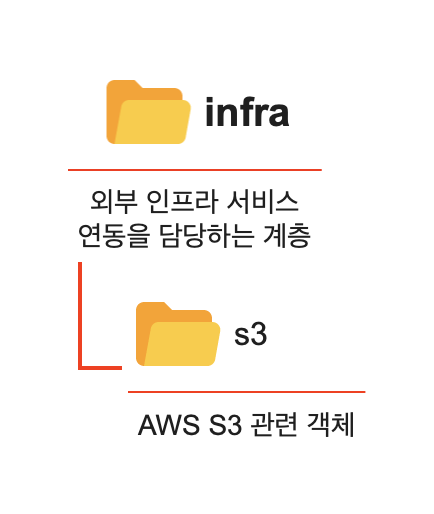

패키지 구조를 **도메인 중심의 비즈니스 로직(domain)**, **공통 기능(global)**, 그리고 **외부 연동(infra)**로 분리하여 유지보수성과 확장성을 높였습니다.

# 🗄️ DB 설계

## 개념적 설계

- ERD(Entity-Relationship Diagram) 작성을 통해 데이터베이스의 개념적 구조를 설계하였습니다.
- 실무적으로 논리적 설계보다 추상화 수준이 높은 단계이므로, 속성의 데이터 타입이나 제약조건과 같은 세부 구현 요소는 고려하지 않았습니다.
- 엔터티(Entity)와 엔터티 간의 관계를 중심으로 표현하였습니다.
- 엔터티 관계는 IE 표기법 및 Crow’s Foot 방식을 활용하여 ERD로 설계하였습니다.

### 관계 차수와 관계 참여도


관계 차수: 0 ~ n

관계 참여도: Optional


관계 차수: 1 ~ n

관계 참여도: Mandatory


관계 차수 : 1

관계 참여도: Mandatory


관계 차수: 0 ~ 1

관계 참여도: Optional

---

### **ERD 작성 순서**

1. 엔티티를 그린다.
2. 엔티티를 적절하게 배치한다.
3. 엔티티간의 관계를 설정한다.

### **🔍 엔터티 측면에서 관계 읽기**

### 사용자(USERS)

사용자 → 게시물


- 한 명의 사용자는 여러 개의 좋아요 된 게시물을 가질 수 있다. (1:N 관계)
- 이유: 사용자는 게시물을 좋아요 할 수 있다. 따라서 한 명의 사용자가 여러 좋아요 된 게시물을 가지는 경우(N)와 좋아요 된 게시물이 없는 경우(Optional)를 합해서 위와 같이 표기한다.

사용자 → 게시물 (좋아요)


- 한 명의 사용자는 여러 개의 좋아요 된 게시물을 가질 수 있다. (1:N 관계)
- 이유: 사용자는 게시물을 좋아요 할 수 있다. 따라서 한 명의 사용자가 여러 좋아요 된 게시물을 가지는 경우(N)와 좋아요 된 게시물이 없는 경우(Optional)를 합해서 위와 같이 표기한다.

사용자 → 게시물 (북마크)


- 한 명의 사용자는 여러 개의 북마크 된 게시물을 가질 수 있다. (1:N 관계)
- 이유: 사용자는 게시물을 북마크할 수 있다. 따라서 한 명의 사용자가 여러 게시물을 북마크하는 경우(N)와 게시물을 북마크하지 않는 경우(Optional)를 합해서 위와 같이 표기한다.

사용자 → 게시물 댓글


- 한 명의 사용자는 다수의 게시물 댓글을 작성할 수 있다. (1:N 관계)
- 이유: 사용자는 다수의 게시물 댓글을 작성한다. 따라서 한 명의 사용자가 다수의 게시물 댓글을 작성하는 경우(N)와 게시물 댓글을 작성하지 않는 경우(Optional)를 합해서 위와 같이 표기한다.

사용자 → 게시물 댓글 (좋아요)


- 한 명의 사용자는 여러 개의 좋아요된 게시물 댓글을 가질 수 있다. (1:N 관계)
- 이유: 사용자는 게시물 댓글에 좋아요를 할 수 있다. 따라서 한 명의 사용자가 여러 좋아요된 게시물 댓글을 가지는 경우(N)와 좋아요된 게시물 댓글이 없는 경우(Optional)를 합해서 위와 같이 표기한다.

사용자 → 팔로우


- 한 명의 사용자는 다수의 팔로우 관계를 가질 수 있다. (1:N 관계)
- 이유: 사용자는 다수의 팔로우 관계를 가진다. 따라서 한 명의 사용자가 다수의 팔로우 관계를 가지는 경우(N)와 다수의 팔로우 관계를 가지지 않는 경우(Optional)를 합해서 위와 같이 표기한다.

사용자 → 장바구니


- 한 명의 사용자는 하나의 장바구니를 항상 가진다. (1:1 관계)
- 이유: 장바구니가 없는 사용자가 없을 수는 없다. 따라서 한 명의 사용자가 하나의 장바구니를 가진 경우(N)와 반드시 장바구니를 가지는 경우(Mandatory) 경우를 합해서 위와 같이 표기한다.

사용자 → 상품 (북마크)


- 한 명의 사용자는 여러 개의 북마크된 상품을 가질 수 있다. (1:N 관계)
- 이유: 사용자는 상품을 북마크할 수 있다. 따라서 한 명의 사용자가 여러 상품을 북마크하는 경우(N)와 상품을 북마크하지 않는 경우(Optional)를 합해서 위와 같이 표기한다.

사용자 → 상품 리뷰


- 한 명의 사용자는 여러 개의 상품 리뷰를 작성할 수 있다. (1:N 관계)
- 이유: 사용자는 여러 상품에 대해 리뷰를 작성할 수 있다. 따라서 한 명의 사용자가 여러 리뷰를 작성하는 경우(N)와 리뷰를 작성하지 않는 경우(Optional)를 합해서 위와 같이 표기한다.

사용자 → 상품 리뷰 (좋아요)


- 한 명의 사용자는 여러 개의 좋아요된 상품 리뷰를 가질 수 있다. (1:N 관계)
- 이유: 사용자는 상품 리뷰에 좋아요를 할 수 있다. 따라서 한 명의 사용자가 여러 좋아요된 상품 리뷰를 가지는 경우(N)와 좋아요된 상품 리뷰가 없는 경우(Optional)를 합해서 위와 같이 표기한다.

사용자 → 상품 리뷰 댓글


- 한 명의 사용자는 여러 개의 상품 리뷰 댓글을 작성할 수 있다. (1:N 관계)
- 이유: 사용자는 여러 상품 리뷰에 댓글을 작성할 수 있다. 따라서 한 명의 사용자가 여러 댓글을 작성하는 경우(N)와 댓글을 작성하지 않는 경우(Optional)를 합해서 위와 같이 표기한다.

사용자 → 주문


- 한 명의 사용자는 여러 개의 주문을 할 수 있다. (1:N 관계)
- 이유: 사용자는 여러 번 주문을 할 수 있다. 따라서 한 명의 사용자가 여러 주문을 하는 경우(N)와 주문을 하지 않는 경우(Optional)를 합해서 위와 같이 표기한다.

사용자 → 배송지


- 한 명의 사용자는 다수의 배송지를 가질 수 있다. (1:N 관계)
- 이유: 사용자는 다수의 배송지를 가질 수 있다. 따라서 한 명의 사용자가 다수의 배송지를 가지는 경우(N)와 다수의 배송지를 가지지 않는 경우(Optional)를 합해서 위와 같이 표기한다.

사용자 → 여행

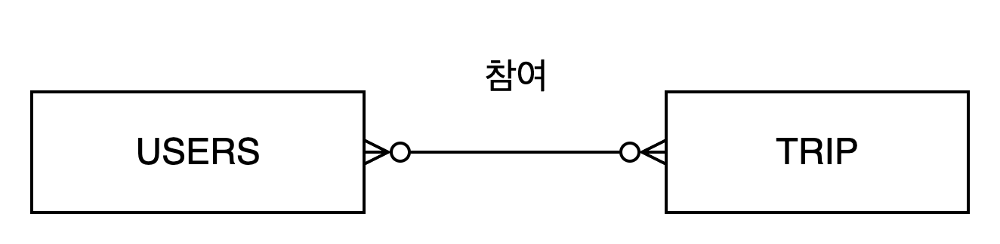

- 한 명의 사용자는 여러 여행에 참여할 수 있다. (1:N 관계)
- 이유: 사용자는 여러 여행에 참여한다. 따라서 한 명의 사용자가 여러 여행에 참여하는 경우(N)와 여행에 참여하지 않는 경우(Optional)를 합해서 위와 같이 표기한다.

사용자 → 나만의 여행 장소


- 한 명의 사용자는 여러 개의 나만의 여행 장소를 등록할 수 있다. (1:N 관계)
- 이유: 사용자는 나만의 여행 장소를 등록할 수 있다. 따라서 한 명의 사용자가 여러 장소를 등록하는 경우(N)와 장소를 등록하지 않는 경우(Optional)를 합해서 위와 같이 표기한다.

사용자 → 여행 장소 (북마크)


- 한 명의 사용자는 여러 개의 북마크된 여행 장소를 가질 수 있다. (1:N 관계)
- 이유: 사용자는 여행 장소를 북마크할 수 있다. 따라서 한 명의 사용자가 여러 여행 장소를 북마크하는 경우(N)와 여행 장소를 북마크하지 않는 경우(Optional)를 합해서 위와 같이 표기한다.

사용자 → 여행 장소 리뷰


- 한 명의 사용자는 여러 개의 여행 장소 리뷰를 작성할 수 있다. (1:N 관계)
- 이유: 사용자는 여러 여행 장소에 대해 리뷰를 작성할 수 있다. 따라서 한 명의 사용자가 여러 리뷰를 작성하는 경우(N)와 리뷰를 작성하지 않는 경우(Optional)를 합해서 위와 같이 표기한다.

사용자 → 여행 장소 리뷰 (좋아요)


- 한 명의 사용자는 여러 개의 좋아요된 여행 장소 리뷰를 가질 수 있다. (1:N 관계)
- 이유: 사용자는 여행 장소 리뷰에 좋아요를 할 수 있다. 따라서 한 명의 사용자가 여러 좋아요된 여행 장소 리뷰를 가지는 경우(N)와 좋아요된 여행 장소 리뷰가 없는 경우(Optional)를 합해서 위와 같이 표기한다.

사용자 → 여행 장소 리뷰 댓글


- 한 명의 사용자는 여러 개의 여행 장소 리뷰 댓글을 작성할 수 있다. (1:N 관계)
- 이유: 사용자는 여러 여행 장소 리뷰에 댓글을 작성할 수 있다. 따라서 한 명의 사용자가 여러 댓글을 작성하는 경우(N)와 댓글을 작성하지 않는 경우(Optional)를 합해서 위와 같이 표기한다.

사용자 → 덱


- 한 명의 사용자는 다수의 덱을 생성할 수 있다. (1:N 관계)
- 이유: 사용자는 다수의 덱을 생성한다. 따라서 한 명의 사용자가 일정이 다수의 덱을 생성하는 경우(N)와 덱이 없는 경우(Optional)를 합해서 위와 같이 표기한다.

사용자 → 퀴즈

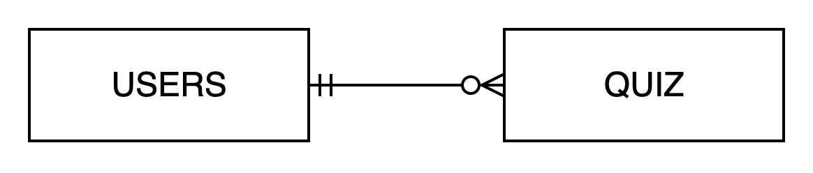

- 한 명의 사용자는 여러 개의 퀴즈를 생성할 수 있다. (1:N 관계)
- 이유: 사용자는 퀴즈를 생성할 수 있다. 따라서 한 명의 사용자가 여러 퀴즈를 생성하는 경우(N)와 퀴즈를 생성하지 않는 경우(Optional)를 합해서 위와 같이 표기한다.

사용자 → 역할


- 한 명의 사용자는 다수의 역할을 가진다. (1:N 관계)
- 이유: 사용자는 시스템에서 반드시 최소 한 개 이상의 역할을 가져야 한다. 따라서 한 명의 사용자가 여러 역할을 가지는 경우(N)와 반드시 가지는 경우(Mandatory)를 합해서 위와 같이 표기한다.

### ROLE(역할)

역할 → 사용자


- 한 개의 역할은 여러 명의 사용자에게 부여될 수 있다. 하지만 어떤 사용자에게도 부여되지 않을 수도 있다. (1:N 관계)
- 이유: 역할은 사용자에게 부여되는 권한 집합으로, 하나의 역할을 여러 사용자가 공유할 수 있으며, 아직 배정되지 않은 역할도 존재할 수 있다. 따라서 역할이 여러 사용자와 연결되는 경우(N)와 연결되지 않을 수도 있는 경우(Optional)를 합하여 위와 같이 표기한다.

### 게시물(POST)

게시물 → 사용자


- 한 개의 게시물은 한 명의 사용자를 가진다. (N:1 관계)
- 이유: 게시물은 반드시 특정 사용자가 작성해야 한다. 사용자가 없는 게시물은 존재할 수 없다. 따라서 게시물은 한 명의 사용자와 경우(1)와 반드시 작성자가 존재하는 경우 (Mandatory)를 합해서 위와 같이 표기한다.

게시물 → 해시태그

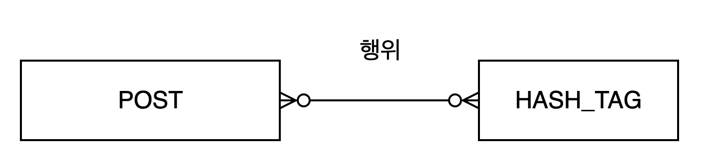

- 한 개의 게시물은 여러 개의 해시태그를 가질 수 있다. (1:N 관계)
- 이유: 게시물은 다양한 주제나 키워드를 표현하기 위해 여러 해시태그를 포함할 수 있다. 따라서 하나의 게시물이 여러 해시태그를 가지는 경우(N)와 해시태그가 없는 경우(Optional)를 합해서 위와 같이 표기한다.

게시물 → 게시물 댓글


- 한 개의 게시물은 여러 개의 댓글을 가질 수 있다. (1:N 관계)
- 이유: 게시물에는 사용자들이 여러 댓글을 작성할 수 있다. 따라서 하나의 게시물이 여러 댓글을 가지는 경우(N)와 댓글이 없는 경우(Optional)를 합해서 위와 같이 표기한다.

게시물 → 사용자 (좋아요)


- 하나의 게시물은 여러 사용자로부터 좋아요를 받을 수 있다. (1:N 관계)
- 이유: 게시물은 여러 사용자에게 좋아요를 받을 수 있다. 따라서 하나의 게시물이 여러 사용자에게 좋아요를 받는 경우(N)와 좋아요를 받지 못하는 경우(Optional)를 합해서 위와 같이 표기한다.

게시물 → 사용자 (북마크)


- 하나의 게시물은 여러 사용자로부터 북마크될 수 있다. (1:N 관계)
- 이유: 게시물은 여러 사용자가 북마크할 수 있다. 따라서 하나의 게시물이 여러 사용자에게 북마크되는 경우(N)와 북마크되지 않는 경우(Optional)를 합해서 위와 같이 표기한다.

### 게시물 댓글(POST_COMMENT)

게시물 댓글 → 게시물


- 하나의 게시물 댓글은 하나의 게시물에만 속할 수 있다. (N:1 관계)
- 이유: 게시물 댓글은 특정 게시물에 작성된다. 따라서 하나의 게시물 댓글이 하나의 게시물에 속하는 경우(N)와 반드시 속하는 경우(Mandatory)를 합해서 위와 같이 표기한다.

게시물 댓글 → 사용자


- 한 개의 게시물 댓글은 한 명의 사용자를 가진다. (N:1 관계)
- 이유: 게시물 댓글은 반드시 특정 사용자가 작성해야 한다. 사용자가 없는 댓글은 존재할 수 없다. 따라서 게시물 댓글은 한 명의 사용자와 경우(1)와 반드시 작성자가 존재하는 경우(Mandatory)를 합해서 위와 같이 표기한다.

게시물 댓글 → 사용자 (좋아요)


- 하나의 게시물 댓글은 여러 사용자로부터 좋아요를 받을 수 있다. (1:N 관계)
- 이유: 게시물 댓글은 여러 사용자에게 좋아요를 받을 수 있다. 따라서 하나의 게시물 댓글이 여러 사용자에게 좋아요를 받는 경우(N)와 좋아요를 받지 못하는 경우(Optional)를 합해서 위와 같이 표기한다.

### 팔로우(FOLLOW)

팔로우 → 사용자


- 한 개의 팔로우 관계는 한 명의 사용자에 의해서 맺어진다. (N:1 관계)
- 이유: 팔로우 관계는 반드시 특정 사용자가 수행해야 한다. 사용자가 없는 팔로우 관계는 존재할 수 없다. 따라서 팔로우 관계는 한 명의 사용자에 의해서 맺어지는 경우(1)와 반드시 팔로우를 수행한 사용자가 존재하는 경우(Mandatory)를 합해서 위와 같이 표기한다.

### 해시태그(HASH_TAG)

해시태그 → 게시물


- 하나의 해시태그는 여러 개의 게시물에 달릴 수 있다. (1:N 관계)
- 이유: 해시태그는 다양한 게시물에서 사용될 수 있으며, 달리지 않는 해시태그도 존재할 수 있다. 따라서 해시태그는 여러 게시물에 달리는 경우(N)와 달리지 않는 경우(Optional)를 합해 위와 같이 표기한다.

### 장바구니(CART)

장바구니 → 사용자


- 한 개의 장바구니는 반드시 한 명의 사용자에 의해서 소유된다. (1:1 관계)
- 이유: 장바구니는 특정 사용자에게 반드시 속해야 하며, 사용자 없이 존재할 수 없다. 따라서 장바구니는 한 명의 사용자1에 의해서 소유되는 경우(1)와 반드시 소유해야하는 경우를 합해서(Mandatory)로 위와 같이 표기한다.

장바구니 → 상품 (담기)

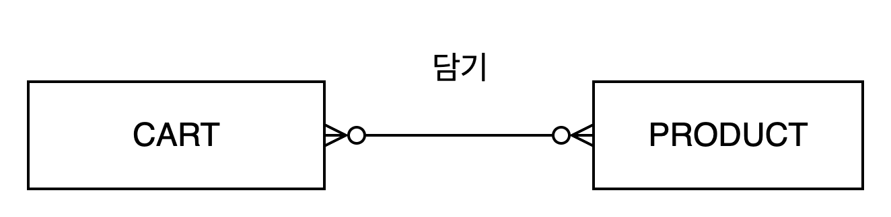

- 한 개의 장바구니는 여러 개의 상품을 담을 수 있다. 하지만 상품을 하나도 담지 않을 수도 있다. (1:N 관계)
- 이유: 장바구니는 생성 직후 비어 있을 수 있으며, 반드시 상품을 담아야만 존재할 필요는 없다. 따라서 장바구니는 상품과의 관계에서 선택적(Optional)로 위와 같이 표기한다.

### 주문(ORDERS)

주문 → 사용자


- 한 개의 주문은 반드시 한 명의 사용자에 의해서 생성된다. (N:1 관계)
- 이유: 주문은 특정 사용자에 반드시 속해야 하며, 사용자 없이 존재할 수 없다. 따라서 주문은 한 명의 사용자에 의해서 생성되는 경우(1)와 반드시 속해야 하는 경우(Mandatory)를 합해서 위와 같이 표기한다.

주문 → 배송


- 한 개의 주문은 반드시 한 개의 배송 정보를 가진다. (1:1 관계)
- 이유: 주문은 반드시 특정 배송 정보와 연결되어야 하며, 배송 정보 없이 존재할 수 없다. 따라서 주문은 반드시 한 개의 배송 정보를 가지는 경우(1)와 반드시 존재해야 하는 경우(Mandatory)로 위와 같이 표기한다.

주문 → 상품

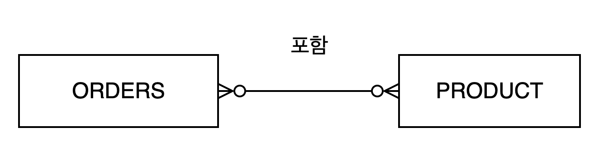

- 한 개의 주문은 여러 개의 상품을 포함할 수 있다. (1:N 관계)
- 이유: 주문은 여러 상품을 포함할 수 있다. 따라서 여러 상품이 포함되는 경우(N)와 상품을 전혀 포함하지 않을 수도 있는 경우(Optional)를 합해서 위와 같이 표기한다.

### 배송지(DELIVERY_ADDRESS)

배송지 → 사용자


- 한 개의 배송지은 반드시 한 명의 사용자에 의해서 생성된다. (N:1 관계)
- 이유: 배송지는 특정 사용자에 반드시 속해야 하며, 사용자 없이 존재할 수 없다. 따라서 배송지는 한 명의 사용자에 의해서 생성되는 경우(1)와 반드시 속해야 하는 경우(Mandatory)를 합해서 위와 같이 표기한다.

배송지 → 배송


- 한 개의 배송지는 여러 배송에 사용될 수 있다. (1:N 관계)
- 이유: 배송지는 여러 배송에 사용된다. 따라서 배송지가 여러 배송에 사용되는 경우(N)와 사용되지 않는 경우(Optional)를 합해서 위와 같이 표기한다.

### 배송(DELIVERY)

배송 → 주문


- 한 개의 배송은 하나의 주문에 속한다. (1:1 관계)
- 이유: 한 배송은 특정 주문으로부터 발생한다. 따라서 한 배송에 반드시 하나의 주문이 연결되는 경우(1)와 반드시 연결되어야 하는 경우(Mandatory)를 합하여 위와 같이 표기한다.

배송 → 배송지


- 한 개의 배송은 하나의 배송지를 가진다. (1:1 관계)
- 이유: 한 배송에는 한 배송지가 사용된다. 따라서 한 배송에 한 배송지가 사용되는 경우(1)와 반드시 사용해야 하는 경우(Mandatory)를 합하여 위와 같이 표기한다.

### 상품(PRODUCT)

상품 → 주문


- 한 개의 상품은 여러 개의 주문에 포함될 수 있다. 하지만 어떤 주문에도 포함되지 않을 수 있다. (1:N 관계)
- 이유: 상품은 여러 주문에 포함될 수 있는 경우(N)와 주문에 포함되지 않을 수 있는 경우(Optional)로 위와 같이 표기한다.

상품 → 장바구니


- 한 개의 상품은 여러 개의 장바구니에 담길 수 있다. 하지만 어떤 장바구니에도 담기지 않을 수 있다. (N:N 관계)
- 이유: 상품은 여러 장바구니에 담기는 경우(N)와 장바구니에 담기지 않을 수 있는 경우(Optional)로 위와 같이 표기한다.

상품 → 카테고리


- 한 개의 상품은 반드시 한 개의 카테고리에 속한다. (N:1 관계)
- 이유: 상품은 반드시 한 개의 카테고리에 속하는 경우(1)와 반드시 존재해야 하는 경우(Mandatory)로 위와 같이 표기한다.

상품 → 리뷰


- 한 개의 상품은 여러 개의 리뷰를 가질 수 있다. 하지만 리뷰를 전혀 가지지 않을 수도 있다. (1:N 관계)
- 이유: 상품은 여러 리뷰를 가지는 경우(N)와 리뷰를 가지지 않을 수 있는 경우(Optional)로 위와 같이 표기한다.

### 인기 상품(POPULAR_PRODUCT)

인기 상품 → 상품


- 한 개의 인기 상품은 하나의 상품에 해당한다. (1:1 관계)
- 이유: 인기 상품은 특정 상품을 기준으로 선정된다. 따라서 한 인기 상품에 반드시 하나의 상품이 연결되는 경우(1)와 반드시 연결되어야 하는 경우(Mandatory)를 합하여 위와 같이 표기한다.

### 카테고리(CATEGORY)

카테고리 → 상품


- 한 개의 상품 카테고리는 여러 개의 상품을 가질 수 있다. 하지만 상품을 전혀 가지지 않을 수도 있다. (0:N 관계)
- 이유: 상품 카테고리는 여러 상품을 가지는 경우(N)와 상품을 가지지 않을 수 있는 경우(Optional)로 위와 같이 표기한다.

### 상품 리뷰(PRODUCT_REVIEW)

상품 리뷰 → 사용자


- 한 개의 상품 리뷰는 반드시 한 명의 사용자에 의해서 작성된다. (N:1 관계)
- 이유: 상품 리뷰는 반드시 한 명의 사용자가 작성하는 경우(1)와 반드시 존재해야 하는 경우(Mandatory)로 위와 같이 표기한다.

상품 리뷰 → 상품


- 한 개의 상품 리뷰는 반드시 한 개의 상품에 속한다. (1:1 관계)
- 이유: 상품 리뷰는 반드시 한 개의 상품에 속하는 경우(1)와 반드시 존재해야 하는 경우(Mandatory)로 위와 같이 표기한다.

상품 리뷰 → 상품 리뷰 댓글


- 한 개의 상품 리뷰는 여러 개의 상품 리뷰 댓글을 가질 수 있다. 하지만 댓글을 전혀 가지지 않을 수도 있다. (1:N 관계)
- 이유: 상품 리뷰는 여러 댓글을 가지는 경우(N)와 댓글을 가지지 않을 수 있는 경우(Optional)로 위와 같이 표기한다.

상품 리뷰 → 사용자 (좋아요)

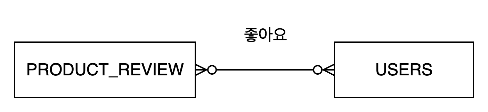

- 한 개의 상품 리뷰는 여러 명의 사용자가 좋아요를 누를 수 있다. 하지만 좋아요가 전혀 없을 수도 있다. (0:N 관계)
- 이유: 상품 리뷰는 여러 사용자가 좋아요를 누르는 경우(N)와 좋아요가 전혀 없는 경우(Optional)로 위와 같이 표기한다.

상품 리뷰 → 인기 상품 리뷰

### 인기 상품 리뷰(PRODUCT_REVIEW)

인기 상품 리뷰 → 상품 리뷰


- 한 개의 인기 상품 리뷰는 하나의 상품 리뷰에 해당한다. (1:1 관계)
- 이유: 인기 상품 리뷰는 특정 상품 리뷰를 기준으로 선정된다. 따라서 한 인기 상품 리뷰에 반드시 하나의 상품 리뷰가 연결되는 경우(1)와 반드시 연결되어야 하는 경우(Mandatory)를 합하여 위와 같이 표기한다.

### 상품 리뷰 댓글(PRODUCT_REVIEW_COMMENT)

상품 리뷰 댓글 → 상품 리뷰


- 한 개의 상품 리뷰 댓글은 반드시 한 개의 상품 리뷰에 속한다. (1:1 관계)
- 이유: 상품 리뷰 댓글은 반드시 한 개의 상품 리뷰에 속하는 경우(1)와 반드시 존재해야 하는 경우(Mandatory)로 위와 같이 표기한다.

상품 리뷰 댓글 → 사용자


- 한 개의 상품 리뷰 댓글은 반드시 한 명의 사용자에 의해서 작성된다. (1:1 관계)
- 이유: 상품 리뷰 댓글은 반드시 한 명의 사용자가 작성하는 경우(1)와 반드시 존재해야 하는 경우(Mandatory)로 위와 같이 표기한다.

### 여행(TRIP)

여행 → 일정


- 한 개의 여행은 여러 개의 일정을 가질 수 있다. 하지만 일정을 전혀 가지지 않을 수도 있다. (1:N 관계)
- 이유: 여행은 여러 일정을 가지는 경우(N)와 일정을 가지지 않을 수 있는 경우(Optional)로 위와 같이 표기한다.

여행 → 사용자 (참여)


- 한 개의 여행에는 여러 명의 사용자가 참여할 수 있다. 하지만 사용자가 전혀 참여하지 않을 수도 있다. (1:N 관계)
- 이유: 여행은 여러 사용자가 참여하는 경우(N)와 사용자가 참여하지 않을 수 있는 경우(Optional)로 위와 같이 표기한다.

여행 → 예산


- 한 개의 여행은 한 개의 예산을 가질 수 있다. 하지만 예산을 전혀 가지지 않을 수도 있다. (1:N 관계)
- 이유: 여행은 예산을 가지는 경우(1)와 예산을 가지지 않을 수 있는 경우(Optional)로 위와 같이 표기한다.

여행 → 체크리스트


- 한 개의 여행은 여러 개의 체크리스트를 가질 수 있다. 하지만 체크리스트를 전혀 가지지 않을 수도 있다. (1:N 관계)
- 이유: 여행은 여러 체크리스트를 가지는 경우(N)와 체크리스트를 가지지 않을 수 있는 경우(Optional)로 위와 같이 표기한다.

### 일정(SCHEDULE)

일정 → 여행


- 한 개의 일정은 반드시 한 개의 여행에 속한다. (1:1 관계)
- 이유: 일정은 반드시 한 개의 여행에 속하는 경우(1)와 반드시 존재해야 하는 경우(Mandatory)로 위와 같이 표기한다.

일정 → 지출


- 한 개의 일정은 여러 개의 지출을 가질 수 있다. 하지만 지출을 전혀 가지지 않을 수도 있다. (1:N 관계)
- 이유: 일정은 여러 지출을 가지는 경우(N)와 지출을 가지지 않을 수 있는 경우(Optional)로 위와 같이 표기한다.

일정 → 여행 장소


- 한 개의 일정은 한 개의 여행 장소를 가질 수 있다. 하지만 여행 장소를 전혀 가지지 않을 수도 있다. (1:1 관계)
- 이유: 일정은 한 개의 여행 장소를 가지는 경우(1)와 여행 장소를 가지지 않을 수 있는 경우(Optional)로 위와 같이 표기한다.

### 여행 장소(TRIP_PLACE)

여행 장소 → 일정


- 한 개의 여행 장소는 여러 일정에 포함될 수 있다. 하지만 어떤 일정에도 포함되지 않을 수도 있다. (1:N 관계)
- 이유: 여행 장소는 여러 일정에 포함되는 경우(N)와 일정에 포함되지 않을 수 있는 경우(Optional)로 위와 같이 표기한다.

여행 장소 → 인기 여행 장소


- 한 개의 여행 장소는 여러 개의 인기 여행 장소에 포함될 수 있다. (1:N 관계)
- 이유: 인기 여행 장소는 특정 여행 장소를 기준으로 선정되며, 선정 기준(에 따라 같은 여행 장소가 여러 번 인기 여행 장소로 뽑힐 수 있다. 그러나 모든 여행 장소가 반드시 인기 여행 장소로 선정되는 것은 아니므로(Optional), 위와 같이 표기한다.

### 인기 여행 장소(POPULAR_TRIP_PLACE)

인기 여행 장소 → 여행 장소


- 한 개의 인기 여행 장소는 하나의 여행 장소에 해당한다. (1:1 관계)
- 이유: 인기 여행 장소는 특정 여행 장소를 기준으로 선정된다. 따라서 한 인기 여행 장소에 반드시 하나의 여행 장소가 연결되는 경우(1)와 반드시 연결되어야 하는 경우(Mandatory)를 합하여 위와 같이 표기한다.

### 여행 장소 리뷰(TRIP_PLACE_REVIEW)

여행 장소 리뷰 → 여행 장소


- 한 개의 여행 장소 리뷰는 반드시 하나의 여행 장소에 속한다. (1:1 관계)
- 이유: 여행 장소 리뷰는 특정 여행 장소를 기반으로 작성된다. 따라서 한 여행 장소 리뷰에는 반드시 하나의 여행 장소가 연결되는 경우(1)와 반드시 연결되어야 하는 경우(Mandatory)를 합하여 위와 같이 표기한다.

여행 장소 리뷰 → 여행 장소 리뷰 댓글


- 한 개의 여행 장소 리뷰는 여러 개의 여행 장소 리뷰 댓글을 가질 수 있다. (1:N 관계)
- 이유: 리뷰에는 0개 이상의 댓글이 달릴 수 있다. 따라서 한 여행 장소 리뷰에 여러 개의 여행 장소 리뷰 댓글이 연결될 수 있는 경우(N)와 연결되지 않아도 되는 경우(Optional)을 합하여 위와 같이 표기한다.

여행 장소 리뷰 → 인기 여행 장소 리뷰


- 한 개의 여행 장소 리뷰는 여러 개의 인기 여행 장소 리뷰에 포함될 수 있다. (1:N 관계)
- 이유: 인기 여행 장소 리뷰는 특정 여행 장소 리뷰를 기준으로 선정되며, 기간이나 조건에 따라 여러 번 선정될 수 있다. 하지만 모든 리뷰가 반드시 인기 리뷰에 선정되는 것은 아니므로 연결되지 않을 수도 있다(Optional) 따라서 1:N, Optional로 표기한다.

### 인기 여행 장소 리뷰(POPULAR_TRIP_PLACE_REVIEW)


- 한 개의 인기 여행 장소 리뷰는 하나의 여행 장소 리뷰에 해당한다. (1:1 관계)
- 이유: 인기 여행 장소 리뷰는 특정 여행 장소 리뷰를 기준으로 선정된다. 따라서 한 인기 여행 장소 리뷰에 반드시 하나의 여행 장소 리뷰가 연결되는 경우(1)와 반드시 연결되어야 하는 경우(Mandatory)를 합하여 위와 같이 표기한다.

### 예산(BUDGET)

개인 예산 → 여행


- 한 개의 개인 예산은 반드시 한 개의 여행에 포함된다. (1:1 관계)
- 이유: 개인 예산은 반드시 한 개의 여행에 포함되는 경우(1)와 반드시 존재해야 하는 경우(Mandatory)로 위와 같이 표기한다.

공동 예산 → 여행


- 한 개의 공동 예산은 반드시 한 개의 여행에 포함된다. (1:1 관계)
- 이유: 공동 예산은 반드시 한 개의 여행에 포함되는 경우(1)와 반드시 존재해야 하는 경우(Mandatory)로 위와 같이 표기한다.

공동 예산 → 예산 참여자


- 한 개의 공동 예산은 여러 명의 예산 참여자를 가진다. (1:N 관계)
- 이유: 공동 예산은 여러 예산 참여자를 가지는 경우(N)와 반드시 존재해야 하는 경우(Mandatory)로 위와 같이 표기한다.

### 예산 참여자(BUDGET_PARTICIPANT)

예산 참여자 → 예산


- 한 명의 예산 참여자는 반드시 한 개의 예산에 포함된다. (1:1 관계)
- 이유: 예산 참여자는 반드시 한 개의 예산에 포함되는 경우(1)와 반드시 존재해야 하는 경우(Mandatory)로 위와 같이 표기한다.

### 지출(EXPENSE)

지출 → 일정


- 한 개의 지출은 반드시 한 개의 일정에 포함된다. (N:1 관계)
- 이유: 지출은 반드시 한 개의 일정에 포함되는 경우(1)와 반드시 존재해야 하는 경우(Mandatory)로 위와 같이 표기한다.

지출 → 지출 참여자


- 한 개의 지출은 여러 명의 지출 참여자를 가진다. (1:N 관계)
- 이유: 지출은 여러 지출 참여자를 가지는 경우(N)와 반드시 존재해야 하는 경우(Mandatory)로 위와 같이 표기한다.

### 지출 참여자(EXPENSE_PARTICIPANT)

지출 참여자 → 지출


- 한 명의 지출 참여자는 반드시 한 개의 지출에 포함된다. (1:1 관계)
- 이유: 지출 참여자는 반드시 한 개의 지출에 포함되는 경우(1)와 반드시 존재해야 하는 경우(Mandatory)로 위와 같이 표기한다.

### 체크리스트(CHECKLIST)

체크리스트 → 체크리스트 항목


- 한 개의 체크리스트는 여러 개의 체크리스트 항목을 가질 수 있다. 하지만 항목을 전혀 가지지 않을 수도 있다. (1:N 관계)
- 이유: 체크리스트는 여러 항목을 가지는 경우(N)와 항목을 가지지 않을 수 있는 경우(Optional)로 위와 같이 표기한다.

### 체크리스트 항목(CHECKLIST_ITEM)

체크리스트 항목 → 체크리스트


- 한 개의 체크리스트 항목은 반드시 한 개의 체크리스트에 포함된다. (1:1 관계)
- 이유: 체크리스트 항목은 반드시 한 개의 체크리스트에 포함되는 경우(1)와 반드시 존재해야 하는 경우(Mandatory)로 위와 같이 표기한다.

### 덱(DECK)

덱 → 카드


- 한 개의 덱은 여러 개의 카드를 가질 수 있다. 하지만 카드를 전혀 가지지 않을 수도 있다. (1:N 관계)
- 이유: 덱은 여러 카드를 가지는 경우(N)와 카드를 가지지 않을 수 있는 경우(Optional)로 위와 같이 표기한다.

### 카드(CARD)

카드 → 덱


- 한 개의 카드는 반드시 한 개의 덱에 포함된다. (1:1 관계)
- 이유: 카드는 반드시 한 개의 덱에 포함되는 경우(1)와 반드시 존재해야 하는 경우(Mandatory)로 위와 같이 표기한다.

### 퀴즈(QUIZ)

퀴즈 → 사용자


- 한 개의 퀴즈는 반드시 한 명의 사용자에 의해서 생성된다. (1:1 관계)
- 이유: 퀴즈는 반드시 한 명의 사용자가 생성하는 경우(1)와 반드시 존재해야 하는 경우(Mandatory)로 위와 같이 표기한다.

퀴즈 → 질문


- 한 개의 퀴즈는 여러 개의 질문을 가진다. (1:N 관계)
- 이유: 퀴즈는 여러 질문을 가지는 경우(N)와 반드시 존재해야 하는 경우(Mandatory)로 위와 같이 표기한다.

### 질문(QUESTION)

질문 → 퀴즈


- 한 개의 질문은 반드시 한 개의 퀴즈에 포함된다. (1:1 관계)
- 이유: 질문은 반드시 한 개의 퀴즈에 포함되는 경우(1)와 반드시 존재해야 하는 경우(Mandatory)로 위와 같이 표기한다.

질문 → 답변


- 한 개의 질문은 한 개의 답변을 가질 수 있다. 하지만 답변을 전혀 가지지 않을 수도 있다. (0:1 관계)
- 이유: 질문은 한 개의 답변을 가지는 경우(1)와 답변을 가지지 않을 수 있는 경우(Optional)로 위와 같이 표기한다.

객관식 질문 → 선지


- 한 개의 객관식 질문은 여러 개의 선지를 가진다. (1:N 관계)
- 이유: 객관식 질문은 여러 선지를 가지는 경우(N)와 반드시 존재해야 하는 경우(Mandatory)로 위와 같이 표기한다.

### 선지(CHOICE)

선지 → 객관식 질문


- 한 개의 선지는 반드시 한 개의 객관식 질문에 포함된다. (1:1 관계)
- 이유: 선지는 반드시 한 개의 객관식 질문에 포함되는 경우(1)와 반드시 존재해야 하는 경우(Mandatory)로 위와 같이 표기한다.

선지 → 객관식 답변


- 한 개의 선지는 한 개의 객관식 답변에서 선택될 수 있다. 하지만 어떤 답변에서도 선택되지 않을 수 있다. (1:1 관계)
- 이유: 선지는 한 개의 객관식 답변에서 선택되는 경우(1)와 선택되지 않을 수 있는 경우(Optional)로 위와 같이 표기한다.

### 답변(ANSWER)

답변 → 질문


- 한 개의 답변은 반드시 한 개의 질문에 포함된다. (1:1 관계)
- 이유: 답변은 반드시 한 개의 질문에 포함되는 경우(1)와 반드시 존재해야 하는 경우(Mandatory)로 위와 같이 표기한다.

객관식 답변 → 선지


- 한 개의 객관식 답변은 반드시 한 개의 선지를 선택한다. (1:1 관계)
- 이유: 객관식 답변은 반드시 한 개의 선지를 선택하는 경우(1)와 반드시 존재해야 하는 경우(Mandatory)로 위와 같이 표기한다.

## 논리적 설계

- 개념적 모델을 기반으로 특정 DBMS 제품에 종속되지 않고, 각 DBMS에서 사용하는 데이터 모델(Data Model)에 맞추어 데이터를 표현하였습니다.
- 산업계에는 여러 데이터 모델이 존재하지만, 사실상 표준처럼 사용되는 관계형 데이터 모델(Relational Model)을 통해 논리적 데이터 구조를 설계하였습니다.
- N:N 관계는 교차 테이블(중간 엔터티)을 활용하여 1:N 관계로 변환하였습니다.
- 각 엔터티의 속성에 대해 데이터 타입, NULL 허용 여부, 기본값, 제약조건 등을 정의하여 엔터티를 릴레이션(테이블)로 변환하였습니다.
- 엔터티 간 관계를 정의할 때, 비식별자 관계와 식별자 관계를 구분하여 표현하였습니다.

### N:N 관계 해소

좋아요


- 실제로는 사용자와 좋아요 대상(게시물, 게시물 댓글, 상품 리뷰, 여행 장소 리뷰 등) 간의 관계는 N:N 구조이다.
  - 한 명의 사용자는 여러 대상에 좋아요를 할 수 있다.
  - 하나의 대상은 여러 사용자의 좋아요를 받을 수 있다.
- 따라서 N:N 관계를 풀어내기 위해 중간 엔터티(Like)를 도입한다.

북마크

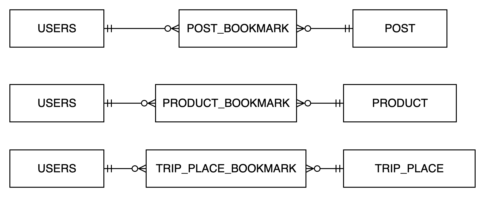

- 실제로는 사용자와 북마크 대상(게시물, 상품, 여행 장소 등) 간의 관계는 N:N 구조이다.
  - 한 명의 사용자는 여러 대상을 북마크할 수 있다.
  - 하나의 대상은 여러 사용자의 북마크가 될 수 있다.
- 따라서 N:N 관계를 풀어내기 위해 중간 엔터티(Bookmark)를 도입한다.

해시태그


- 실제로는 게시물과 해시태그 간의 관계는 N:N 구조이다.
  - 하나의 게시물에는 여러 해시태그가 포함될 수 있다.
  - 하나의 해시태그는 여러 게시물에 사용될 수 있다.
- 따라서 N:N 관계를 풀어내기 위해 중간 엔터티(POST_HASHTAG)를 도입한다.

여행 참여


- 실제로는 사용자와 여행 간의 관계는 N:N 구조이다.
  - 한 명의 사용자는 여러 여행에 참여할 수 있다.
  - 하나의 여행은 여러 사용자가 함께 참여할 수 있다.
- 따라서 N:N 관계를 풀어내기 위해 중간 엔터티(TRIP_JOIN)을 도입한다.

주문 상품


- 실제로는 주문과 상품 간의 관계는 N:N 구조이다.
  - 하나의 주문에는 여러 상품이 포함될 수 있다.
  - 하나의 상품은 여러 주문에 포함될 수 있다.
- 따라서 N:N 관계를 풀어내기 위해 중간 엔터티(ORDER_PRODUCT)을 도입한다.

장바구니 상품


- 실제로는 장바구니와 상품 간의 관계는 N:N 구조이다.
  - 하나의 장바구니에는 여러 상품이 담길 수 있다.
  - 하나의 상품은 여러 장바구니에 담길 수 있다.
- 따라서 N:N 관계를 풀어내기 위해 중간 엔터티(Cart_PRODUCT)을 도입한다.

### 최종 ERD 다이어그램

👉 [Draw.io에서 직접 보기](https://drive.google.com/file/d/1Jm4ge2oExJ3M_bNiNgYqHT4LxJ4xHg4g/view?usp=sharing)

## 물리적 설계

논리적 설계로 만들어진 결과를 통해 프로젝트에 사용할 DBMS 제품 중에 MYSQL에 맞는 DDL 구문으로 변환하여 테이블을 생성했습니다.

작성 중...

# 🔌 API 설계

## 공통 응답 형식

```java
public class ApiResponse<T> {
    private boolean status;
    private T data;
    private ErrorResponse error;

    private ApiResponse(boolean status, T data, ErrorResponse error) {
        this.status = status;
        this.data = data;
        this.error = error;
    }

    public static <T> ApiResponse<T> success(T data) {
        return new ApiResponse<>(true, data, null);
    }

    public static <T> ApiResponse<T> validationFail(BindingResult bindingResult) {
        return new ApiResponse<>(
                false,
                null,
                ErrorResponse.of(CommonErrorCode.INVALID_INPUT_VALUE, bindingResult)
        );
    }

    public static <T> ApiResponse<T> error(ErrorCode errorCode) {
        return new ApiResponse<>(
                false,
                null,
                ErrorResponse.of(errorCode)
        );
    }
}

```

모든 API 응답은 일관된 형식으로 유지하기 위해 위와 같은 공통 객체를 사용했습니다.

## 예외 계층 구조

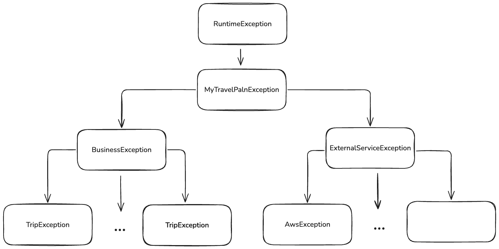

### **예외 유형**

- **BusinessException**: Service 단에서 발생하는 비즈니스 로직 관련 예외 (RuntimeException 상속)
- **ExternalServiceException**: 외부 시스템과 연동 과정에서 발생하는 예외 (RuntimeException 상속)

예외 처리는 `GlobalExceptionHandler`를 통해 중앙 집중식으로 관리했습니다.

## 에러 응답 형식

### 에러 응답 객체

```java
@Getter
@NoArgsConstructor(access = AccessLevel.PROTECTED)
@JsonInclude(JsonInclude.Include.NON_NULL)
public class ErrorResponse {
    private String code;
    private String message;
    private List<FieldError> fieldErrors;

    private ErrorResponse(final ErrorCode errorCode, List<FieldError> fieldErrors) {
        this.code = errorCode.getCode();
        this.message = errorCode.getMessage();
        this.fieldErrors = fieldErrors;
    }

    private ErrorResponse(final ErrorCode errorCode) {
        this.code = errorCode.getCode();
        this.message = errorCode.getMessage();
    }

    public static ErrorResponse of(ErrorCode errorCode) {
        return new ErrorResponse(
                errorCode
        );
    }

    public static ErrorResponse of(ErrorCode errorCode, BindingResult bindingResult) {
        return new ErrorResponse(
                errorCode,
                FieldError.of(bindingResult)
        );
    }

    @Getter
    static class FieldError {
        private final String field;
        private final Object rejectedValue;
        private final String message;

        private FieldError(String field, Object rejectedValue, String message) {
            this.field = field;
            this.rejectedValue = rejectedValue;
            this.message = message;
        }

        public static List<FieldError> of(BindingResult bindingResult) {
            return bindingResult.getFieldErrors()
                    .stream()
                    .map(error -> new FieldError(
                            error.getField(),
                            error.getRejectedValue(),
                            error.getDefaultMessage()
                    ))
                    .toList();
        }
    }
}
```

요청 처리 중 예외가 발생하면 API는 HTTP 상태 코드와 함께 명확한 에러 객체를 반환하도록 했습니다.

에러 코드와 상세 메시지 설명은 [**에러 코드**](https://www.notion.so/198f027bcf0d80aeac1df12561d99f25?pvs=21)를 참고하도록 했습니다.

### 응답 예시:

**비즈니스 예외인 경우**

```json
{
  "success": false,
  "error": {
    "code": "AC1",
    "message": "잔액이 부족합니다"
  }
}
```

**유효성 검사 예외인 경우**

```json
{
  "success": false,
  "error": {
    "code": "C1",
    "message": "입력값 검증에 실패했습니다",
    "fieldErrors": [
      {
        "field": "email",
        "rejectedValue": "invalid-email",
        "message": "올바른 이메일 형식이 아닙니다"
      },
      {
        "field": "password",
        "rejectedValue": "123",
        "message": "비밀번호는 최소 8자 이상이어야 합니다"
      }
    ]
  }
}
```

### 에러 코드

에러 코드는 Enum 타입을 확장하여 응답 코드를 관리하고, 각 도메인에 맞는 예외 코드를 구분하여 커스텀 예외처리 방법을 선택했습니다. 이러한 선택은 도메인마다 응답 코드를 관리하고 코드의 일관성과 가독성을 높이고 클라이언트에게 명확하고 유용한 정보를 제공하여 디버깅 및 문제 해결을 용이 위함이었습니다.

### Common(공통)

| **Enum Constant**     | **HTTP Status** | **Code**  | **Error Message**                |
| --------------------- | --------------- | --------- | -------------------------------- |
| INTERNAL_SERVER_ERROR | 500             | COMMON-01 | 서버에 내부 오류가 발생했습니다. |
| INVALID_REQUEST       | 400             | COMMON-02 | 유효성 검사에 실패했습니다.      |
| METHOD_NOT_ALLOWED    | 405             | COMMON-03 | 지원하지 않는 HTTP 메서드입니다. |
| UNAUTHORIZED          | 401             | COMMON-04 | 인증되지 않는 사용자입니다.      |
| _FORBIDDEN_           | 403             | COMMON-05 | 접근이 금지된 리소스입니다.      |

### 사용자(User)

| **Enum Constant**       | **HTTP Status** | **Code** | **Error Message**                  |
| ----------------------- | --------------- | -------- | ---------------------------------- |
| USER_NOT_FOUND          | 404             | USER-01  | 사용자를 찾을 수 없습니다.         |
| DUPLICATE_USER          | 400             | USER-02  | 이미 존재하는 사용자입니다.        |
| USER_CANNOT_FOLLOW_SELF | 400             | USER-03  | 자신을 팔로우할 수 없습니다.       |
| USER_ALREADY_FOLLOWING  | 400             | USER-04  | 이미 팔로우하고 있는 사용자입니다. |

### 인증(Auth)

| **Enum Constant**                 | **HTTP Status** | **Code** | **Error Message**                                   |
| --------------------------------- | --------------- | -------- | --------------------------------------------------- |
| NOT_FOUND_REFRESH_TOKEN_IN_COOKIE | 400             | AUTH-01  | 쿠키에서 리프레쉬 토큰을 찾을 수 없습니다.          |
| INVALID_REFRESH_TOKEN             | 401             | AUTH-02  | 유효하지 않는 리프레시 토큰입니다.                  |
| NOT_FOUND_USER_IN_REFRESH_TOKEN   | 401             | AUTH-03  | 제공된 리프레쉬 토큰으로 사용자를 찾을 수 없습니다. |
| ALREADY_ADDED_ADDITIONAL_INFO     | 400             | AUTH-04  | 추가 정보가 이미 등록되어 있습니다.                 |

### 게시물(Post)

| **Enum Constant** | **HTTP Status** | **Code** | **Error Message**          |
| ----------------- | --------------- | -------- | -------------------------- |
| POST_NOT_FOUND    | 404             | POST-01  | 게시물을 찾을 수 없습니다. |

### 게시물 댓글(PostComment)

| **Enum Constant**               | **HTTP Status** | **Code**        | **Error Message**                            |
| ------------------------------- | --------------- | --------------- | -------------------------------------------- |
| POST_COMMENT_NOT_FOUND          | 404             | POST_COMMENT-01 | 게시물 댓글을 찾을 수 없습니다.              |
| POST_COMMENT_NOT_BELONG_TO_POST | 400             | POST_COMMENT-02 | 게시물 댓글이 해당 게시물에 속하지 않습니다. |

### 알람(Notification)

| **Enum Constant**      | **HTTP Status** | **Code** | **Error Message**             |
| ---------------------- | --------------- | -------- | ----------------------------- |
| NOTIFICATION_NOT_FOUND | 404             | TRIP-01  | 알람 정보를 찾을 수 없습니다. |

### 여행(Trip)

| **Enum Constant** | **HTTP Status** | **Code** | **Error Message**        |
| ----------------- | --------------- | -------- | ------------------------ |
| TRIP_NOT_FOUND    | 404             | TRIP-01  | 여행을 찾을 수 없습니다. |

### 통화(Currency)

| **Enum Constant**  | **HTTP Status** | **Code**    | **Error Message**        |
| ------------------ | --------------- | ----------- | ------------------------ |
| CURRENCY_NOT_FOUND | 404             | CURRENCY-01 | 통화를 찾을 수 없습니다. |

### 여행 장소(Trip_Place)

| **Enum Constant**    | **HTTP Status** | **Code**      | **Error Message**             |
| -------------------- | --------------- | ------------- | ----------------------------- |
| TRIP_PLACE_NOT_FOUND | 404             | TRIP_PLACE-01 | 여행 장소를 찾을 수 없습니다. |

### 나만의 장소(Custom_Place)

| **Enum Constant**      | **HTTP Status** | **Code**        | **Error Message**               |
| ---------------------- | --------------- | --------------- | ------------------------------- |
| CUSTOM_PLACE_NOT_FOUND | 404             | CUSTOM_PLACE-01 | 나만의 장소를 찾을 수 없습니다. |

### 여행 장소 리뷰(TripPlaceReview)

| **Enum Constant**                     | **HTTP Status** | **Code**             | **Error Message**                                  |
| ------------------------------------- | --------------- | -------------------- | -------------------------------------------------- |
| TRIP_PLACE_REVIEW_NOT_FOUND           | 404             | TRIP_PLACE_REVIEW-01 | 여행 장소 리뷰를 찾을 수 없습니다.                 |
| TRIP_PLACE_REVIEW_NOT_BELONG_TO_PLACE | 400             | TRIP_PLACE_REVIEW-02 | 여행 장소 리뷰가 해당 여행 장소에 속하지 않습니다. |

### 여행 장소 리뷰 댓글(TripPlaceReviewComment)

| **Enum Constant**                     | **HTTP Status** | **Code**             | **Error Message**                                  |
| ------------------------------------- | --------------- | -------------------- | -------------------------------------------------- |
| TRIP_PLACE_REVIEW_NOT_FOUND           | 404             | TRIP_PLACE_REVIEW-01 | 여행 장소 리뷰를 찾을 수 없습니다.                 |
| TRIP_PLACE_REVIEW_NOT_BELONG_TO_PLACE | 400             | TRIP_PLACE_REVIEW-02 | 여행 장소 리뷰가 해당 여행 장소에 속하지 않습니다. |

### 일정(Schedule)

| **Enum Constant**                    | **HTTP Status** | **Code**    | **Error Message**                          |
| ------------------------------------ | --------------- | ----------- | ------------------------------------------ |
| SCHEDULE_NOT_FOUND                   | 404             | SCHEDULE-01 | 일정을 찾을 수 없습니다.                   |
| SCHEDULE_DATE_TIME_OUT_OF_TRIP_RANGE | 400             | SCHEDULE-02 | 일정 날짜가 여행 날짜 범위를 벗어났습니다. |
| SCHEDULE_NOT_BELONG_TO_TRIP          | 400             | SCHEDULE-03 | 일정이 해당 여행에 속하지 않습니다.        |

### 지출(Expense)

| **Enum Constant**                  | **HTTP Status** | **Code**   | **Error Message**                            |
| ---------------------------------- | --------------- | ---------- | -------------------------------------------- |
| EXPENSE_NOT_FOUND                  | 404             | EXPENSE-01 | 지출를 찾을 수 없습니다.                     |
| PAYER_NOT_FOUND                    | 404             | EXPENSE-02 | 지출의 지불자를 찾을 수 없습니다.            |
| INVALID_CALCULATE_TYPE             | 400             | EXPENSE-03 | 지출의 정산 방식이 올바르지 않습니다.        |
| EXPENSE_PARTICIPANT_NOT_FOUND      | 404             | EXPENSE-04 | 지출 참여자를 찾을 수 없습니다.              |
| DUPLICATE_EXPENSE_PARTICIPANTS     | 400             | EXPENSE-05 | 지출 참여자 목록에 중복된 사용자가 있습니다. |
| INVALID_EXPENSE_PARTICIPANT_AMOUNT | 400             | EXPENSE-06 | 지출 참여자의 금액이 올바르지 않습니다.      |

### 예산(Budget)

| **Enum Constant**                 | **HTTP Status** | **Code**  | **Error Message**                                       |
| --------------------------------- | --------------- | --------- | ------------------------------------------------------- |
| BUDGET_NOT_FOUND                  | 404             | BUDGET-01 | 파일 업로드을 위한 사전 서명된 URL 생성에 실패했습니다. |
| INVALID_BUDGET_TYPE               | 400             | BUDGET-02 | 예산의 유형이 올바르지 않습니다.                        |
| INVALID_CALCULATE_TYPE            |                 | BUDGET-03 | 예산의 정산 방식이 올바르지 않습니다.                   |
| BUDGET_PARTICIPANT_NOT_FOUND      | 400             | BUDGET-04 | 예산 참여자를 찾을 수 없습니다.                         |
| DUPLICATE_BUDGET_PARTICIPANTS     |                 | BUDGET-05 | 예산 참여자 목록에 중복된 사용자가 있습니다.            |
| INVALID_BUDGET_PARTICIPANT_AMOUNT |                 | BUDGET-06 | 예산 참여자의 금액이 올바르지 않습니다.                 |

### 일기(Diary)

| **Enum Constant** | **HTTP Status** | **Code** | **Error Message**        |
| ----------------- | --------------- | -------- | ------------------------ |
| DIARY_NOT_FOUND   | 404             | DIARY-01 | 일기를 찾을 수 없습니다. |

### 상품(Product)

| **Enum Constant**  | **HTTP Status** | **Code**   | **Error Message**        |
| ------------------ | --------------- | ---------- | ------------------------ |
| PRODUCT_NOT_FOUND  | 404             | PRODUCT-01 | 상품을 찾을 수 없습니다. |
| INSUFFICIENT_STOCK | 400             | PRODUCT-02 | 재고가 부족합니다.       |

### 카테고리(Category)

| **Enum Constant**  | **HTTP Status** | **Code**  | **Error Message**            |
| ------------------ | --------------- | --------- | ---------------------------- |
| CATEGORY_NOT_FOUND | 404             | BUDGET-01 | 카테고리를 찾을 수 없습니다. |

### 상품 리뷰(ProductReview)

| **Enum Constant**                    | **HTTP Status** | **Code**          | **Error Message**                        |
| ------------------------------------ | --------------- | ----------------- | ---------------------------------------- |
| PRODUCT_REVIEW_NOT_FOUND             | 404             | PRODUCT_REVIEW-01 | 상품 리뷰를 찾을 수 없습니다.            |
| PRODUCT_REVIEW_NOT_BELONG_TO_PRODUCT | 400             | PRODUCT_REVIEW-02 | 상품 리뷰가 해당 상품에 속하지 않습니다. |

### 상품 리뷰 댓글(ProductReviewComment)

| **Enum Constant**                | **HTTP Status** | **Code**                  | **Error Message**                  |
| -------------------------------- | --------------- | ------------------------- | ---------------------------------- |
| PRODUCT_REVIEW_COMMENT_NOT_FOUND | 404             | PRODUCT_REVIEW_COMMENT-01 | 상품 리뷰 댓글을 찾을 수 없습니다. |

### 문의(Inquiry)

| **Enum Constant** | **HTTP Status** | **Code**   | **Error Message**        |
| ----------------- | --------------- | ---------- | ------------------------ |
| INQUIRY_NOT_FOUND | 404             | INQUIRY-01 | 문의를 찾을 수 없습니다. |

### 장바구니(Cart)

| **Enum Constant** | **HTTP Status** | **Code** | **Error Message**            |
| ----------------- | --------------- | -------- | ---------------------------- |
| CART_NOT_FOUND    | 404             | CART-01  | 장바구니를 찾을 수 없습니다. |

### 주문(Order)

| **Enum Constant**   | **HTTP Status** | **Code** | **Error Message**                                    |
| ------------------- | --------------- | -------- | ---------------------------------------------------- |
| ORDER_NOT_FOUND     | 404             | ORDER-01 | 주문 정보를 찾을 수 없습니다.                        |
| CANNOT_CANCEL_ORDER | 400             | ORDER-02 | 배송 중이거나 배송 완료된 주문은 취소할 수 없습니다. |

### 체크리스트(CheckList)

| **Enum Constant**             | **HTTP Status** | **Code**     | **Error Message**                         |
| ----------------------------- | --------------- | ------------ | ----------------------------------------- |
| CHECK_LIST_NOT_FOUND          | 404             | CHECKLIST-01 | 체크리스트를 찾을 수 없습니다.            |
| CHECK_LIST_NOT_BELONG_TO_TRIP | 400             | CHECKLIST-02 | 체크리스트가 해당 여행에 속하지 않습니다. |

### 체크리스트 항목(CheckListItem)

| **Enum Constant**        | **HTTP Status** | **Code**          | **Error Message**                   |
| ------------------------ | --------------- | ----------------- | ----------------------------------- |
| CHECK_LIST_ITEM_NOT_FOUN | 404             | CHECKLIST_ITEM-01 | 체크리스트 항목을 찾을 수 없습니다. |

### 배송지(DeliveryAddress)

| **Enum Constant**          | **HTTP Status** | **Code**            | **Error Message**          |
| -------------------------- | --------------- | ------------------- | -------------------------- |
| DELIVERY_ADDRESS_NOT_FOUND | 404             | DELIVERY_ADDRESS-01 | 배송지를 찾을 수 없습니다. |

### 배송(Delivery)

| **Enum Constant**  | **HTTP Status** | **Code**    | **Error Message**             |
| ------------------ | --------------- | ----------- | ----------------------------- |
| DELIVERY_NOT_FOUND | 404             | DELIVERY-01 | 배송 정보를 찾을 수 없습니다. |

### 덱(Deck)

| **Enum Constant** | **HTTP Status** | **Code** | **Error Message**      |
| ----------------- | --------------- | -------- | ---------------------- |
| DECK_NOT_FOUND    | 404             | DECK-01  | 덱을 찾을 수 없습니다. |

### 카드(Card)

| **Enum Constant**       | **HTTP Status** | **Code** | **Error Message**                 |
| ----------------------- | --------------- | -------- | --------------------------------- |
| CARD_NOT_FOUND          | 404             | CARD-01  | 카드를 찾을 수 없습니다.          |
| CARD_NOT_BELONG_TO_DECK | 400             | CARD-02  | 카드가 해당 덱에 속하지 않습니다. |

### 퀴즈(Quiz)

| **Enum Constant**     | **HTTP Status** | **Code** | **Error Message**           |
| --------------------- | --------------- | -------- | --------------------------- |
| QUIZ_NOT_FOUND        | 404             | QUIZ-01  | 퀴즈를 찾을 수 없습니다.    |
| QUIZ_NOT_FINISHED     | 400             | QUIZ-02  | 퀴즈가 완료되지 않았습니다. |
| QUIZ_ALREADY_FINISHED | 400             | QUIZ-03  | 퀴즈가 이미 완료되었습니다. |

### 질문(Question)

| **Enum Constant**  | **HTTP Status** | **Code**    | **Error Message**        |
| ------------------ | --------------- | ----------- | ------------------------ |
| QUESTION_NOT_FOUND | 404             | QUESTION-01 | 질문을 찾을 수 없습니다. |

### AmazonS3

| **Enum Constant**                | **HTTP Status** | **Code**    | **Error Message**                                       |
| -------------------------------- | --------------- | ----------- | ------------------------------------------------------- |
| FAILED_TO_GENERATE_PRESIGNED_URL | 404             | AMAZONS3-01 | 파일 업로드을 위한 사전 서명된 URL 생성에 실패했습니다. |

## API 명세서

## API 명세서

### 사용자(User)

[사용자 API](https://www.notion.so/27cfd55ecc78817fba30f03a2b5e31bc?pvs=21)

### 인증(Auth)

[인증 API](https://www.notion.so/27cfd55ecc7881d2bbefdf9ae8111b8a?pvs=21)

### 게시물(Post)

[게시물 API](https://www.notion.so/27cfd55ecc78810e8b55c9132cc8a792?pvs=21)

### 여행(Trip)

[여행 API](https://www.notion.so/27cfd55ecc7881ff8cb4e8af0dcd80ec?pvs=21)

### 통화(Currency)

[통화 API](https://www.notion.so/27cfd55ecc7881fabd37c44e63aad30f?pvs=21)

### 여행 장소(TripPlace)

[여행 장소 API](https://www.notion.so/2aafd55ecc7881ebaab5d0c0fab28128?pvs=21)

### 나만의 장소(CustomPlace)

[나만의 장소 API](https://www.notion.so/2a9fd55ecc78813484c6e3849f0d4ff0?pvs=21)

### 일정(Schedule)

[일정 API](https://www.notion.so/27cfd55ecc7881868f53de09b8b3eabf?pvs=21)

### 지출(Expense)

[지출 API](https://www.notion.so/27cfd55ecc788101a5b2e3557b3f7a9d?pvs=21)

### 예산(Budget)

[예산 API](https://www.notion.so/27cfd55ecc78810ea497ee843ddfca79?pvs=21)

### 일기(Diary)

[일기 API](https://www.notion.so/27cfd55ecc7881fd97dbda4ce989ef0b?pvs=21)

### 상품(Product)

[상품 API](https://www.notion.so/27cfd55ecc78812cb6f9c668286c9bdc?pvs=21)

### 카테고리(Category)

[카테고리 API](https://www.notion.so/293fd55ecc7880048b29d71144903c87?pvs=21)

### 문의(Inquiry)

[문의 API](https://www.notion.so/27cfd55ecc7881829c09d92b4f4a7720?pvs=21)

### 장바구니(Cart)

[장바구니 API](https://www.notion.so/27cfd55ecc7881558e03cbebb6fcd081?pvs=21)

### 주문(Order)

[주문 API](https://www.notion.so/27cfd55ecc7881b3aff4ef84c3568737?pvs=21)

### 체크리스트 (CheckList)

[체크리스트 API](https://www.notion.so/27cfd55ecc78818c99c7eba60acc99db?pvs=21)

### 체크리스트 항목(CheckListItem)

[체크리스트 항목 API](https://www.notion.so/27cfd55ecc78813f944cc6ae1a400b94?pvs=21)

### 배송지(DeliveryAddress)

[배송지 API](https://www.notion.so/27cfd55ecc78819fbd3fecc08deac259?pvs=21)

### 배송(Delivery)

[배송 API](https://www.notion.so/2aafd55ecc78811690dec090e3e87bf9?pvs=21)

### 덱(Deck)

[덱 API](https://www.notion.so/27cfd55ecc7881f891cec6445fe6a328?pvs=21)

### 카드(Card)

[카드 API](https://www.notion.so/27cfd55ecc7881a3b640d43b946e76c0?pvs=21)

### 퀴즈(Quiz)

[퀴즈 API](https://www.notion.so/27cfd55ecc788176ad0ae41261e7cda9?pvs=21)

### 질문(Question)

[질문 API](https://www.notion.so/27cfd55ecc78814e8403c551875e58e9?pvs=21)

# ✅ 테스트 코드

## 단위 테스트

### Controller

- 웹 레이어만 @ WebMvcTest로 올리고, MockMvc로 엔드포인트를 때려서 요청→검증→응답 플로우를 체크
- 입력값은 Bean Validation, 응답은 상태 코드/헤더/JSON 구조를 기준으로 검증
- 예외는 @ ControllerAdvice 매핑 확인. Service는 @ MockBean으로 주입
- @AutoConfigureRestDocs 어노테이션과 .andDo(document(...)) 를 이용해 RestDocs 문서 스니펫 파일을 생성

```java
@ActiveProfiles("test")
@AutoConfigureRestDocs
@Import({TestSecurityConfig.class, JwtAuthenticationSuccessHandler.class, JwtAuthenticationFailureHandler.class, JwtAuthenticationEntryPoint.class, JwtAccessDeniedHandler.class, MyTravelPlanPermissionEvaluator.class, JwtUtils.class})
public abstract class ControllerTestSupport {
    @Autowired
    protected MockMvc mockMvc;

    @Autowired
    protected ObjectMapper objectMapper;

    @MockitoBean
    protected JwtBlacklistService jwtBlacklistService;

    @Autowired
    protected JwtUtils jwtUtils;

    ....
}
```

```java
@WebMvcTest(value = UserController.class)
@DisplayName("사용자 컨트롤러 테스트")
public class UserControllerTest extends ControllerTestSupport {

    @MockitoBean
    private UserService userService;

    @Test
    @DisplayName("회원가입")
    void join() throws Exception {
            // given, when, then 패턴으로 테스트 작성
    }
}
```

### Service

- 메서드 단위에서 비즈니스 로직과 트랜잭션 처리, 예외 변환이 올바른지 검증. Repository와 외부 연동은 Mock으로 대체해 의존성을 제거하고, 성공/실패/경계값 등 시나리오별로 기대 반환값과 발생 예외를 점검.

```java
@ActiveProfiles("test")
@ExtendWith(MockitoExtension.class)
public abstract class ServiceTestSupport {

}
```

```java
@DisplayName("사용자 서비스 테스트")
class UserServiceTest extends ServiceTestSupport {

    @Mock
    UserRepository userRepository;

    @Mock
    UserProfileRepository userProfileRepository;

    @Mock
    FollowRepository followRepository;

    @Mock
    PasswordEncoder passwordEncoder;

    @Mock
    UserMapper userMapper;

    @Mock
    UserProfileMapper userProfileMapper;

    @Mock
    FollowMapper followMapper;

    @InjectMocks
    UserService userService;

    @Test
    @DisplayName("회원가입을 성공적으로 수행")
    void join_success() {
        // given, when, then 패턴으로 테스트 작성
    }
}
```

### Repository

- @ DataJpaTest로 Repository와 EntityManager 등 JPA 슬라이스만 띄운 뒤, 데이터가 올바르게 저장, 업데이트, 삭제되는지 점검
- 플러시 후 영속성 컨텍스트와 실제 데이터베이스의 상태가 일치하는지 확인
- @Query, QueryDSL, 복잡한 조건의 메서드 쿼리가 기대한 데이터를 반환하는지도 검증

```java
@ActiveProfiles("test")
@EnableJpaAuditing
@DataJpaTest
@Import(QueryDSLConfig.class)
public abstract class RepositoryTestSupport {
    @Autowired
    EntityManager em;
}
```

```java
@DisplayName("사용자 레포지토리 테스트")
public class UserRepositoryTest extends RepositoryTestSupport {
    @Autowired
    UserRepository userRepository;

    @Test
    @DisplayName("사용자 이름으로 사용자를 찾을 수 있다")
    void findByUsername_ExistingUsername_ReturnsUser() {
        // given, when, then 패턴으로 테스트 작성
    }
}
```

## 통합 테스트

- 실제 구동되는 애플리케이션과 똑같은 애플리케이션 컨텍스트를 로드하여 Spring Security, Redis(리프레시 토큰 저장·블랙리스트 관리), H2 Database, JPA를 포함한 API 엔드포인트의 전체 흐름을 검증

```java
@SpringBootTest
@AutoConfigureMockMvc
@ActiveProfiles("test")
@Transactional
public abstract class IntegrationTestSupport {
    @Autowired
    protected MockMvc mockMvc;

    @Autowired
    protected ObjectMapper objectMapper;

    @Autowired
    protected JwtUtils jwtUtils;
}

```

```java
@ActiveProfiles("test")
@SpringBootTest
@AutoConfigureMockMvc
@Transactional
@DisplayName("사용자 통합 테스트")
public class UserIntegrationTest {
    @Autowired
    MockMvc mockMvc;

    @Autowired
    ObjectMapper objectMapper;

    @Autowired
    UserService userService;

    @Test
    @DisplayName("사용자 회원가입")
    void createUser() throws Exception {
        // given, when, then 패턴으로 테스트 작성
    }
```
